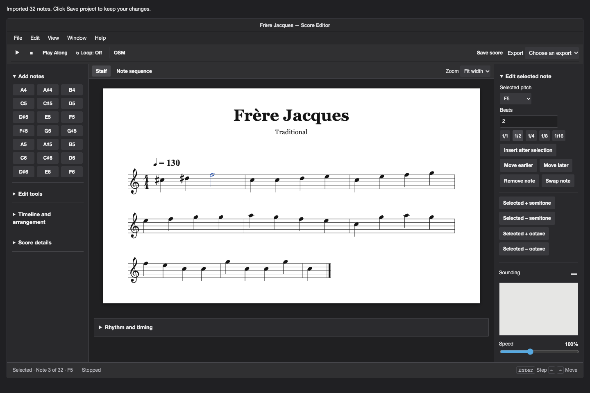
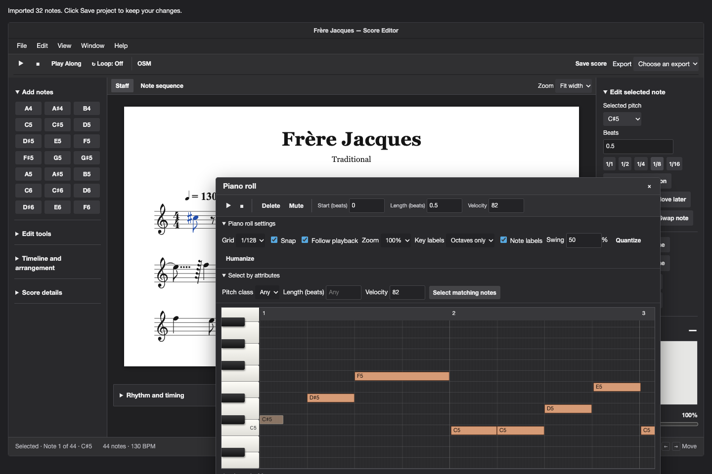
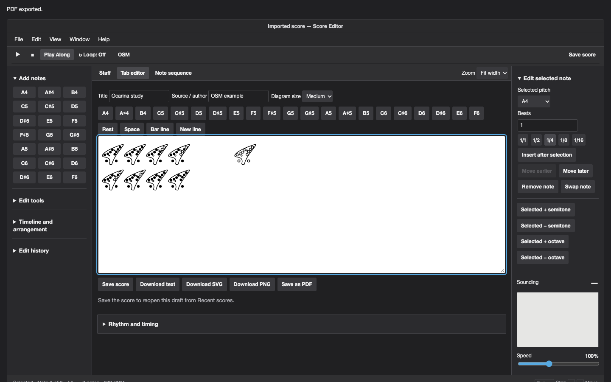
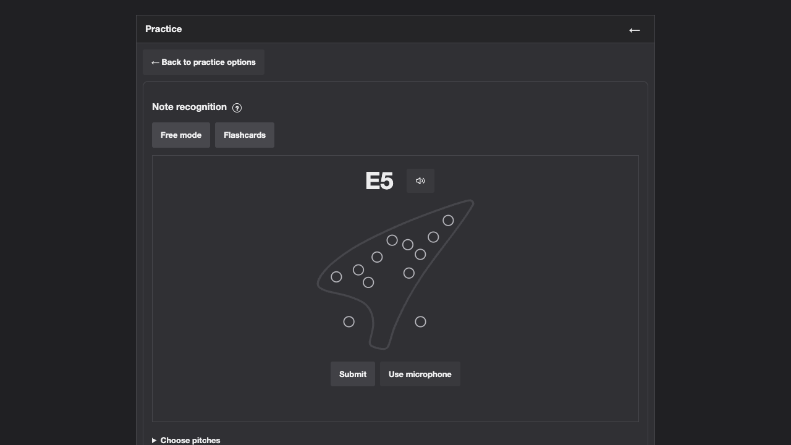

# Ocarina Song Mapper

**[Open OSM in your browser](https://kyirinou.github.io/ocarina-song-mapper/)**

**Available on Windows, macOS, Linux, Android, and iOS**

Ocarina Song Mapper (or OSM for short) is a versitile tool to help you learn and play your ocarina! Right now we only support an Alto C, 12 hole ocarina, but more are planned in the future! I'm really happy with the development of this so far. And if you happen to find any bugs: Please click Issues → New issue to report anything that may disrupt the user experience!

## Features!! (Including but not limited to)

- **Build and edit scores.**
  Start with a blank score, paste note names such as `A4 - D#5 - C5 - F6`, or import supported ABC, MIDI, or MusicXML. Click a note card to hear it. Edit pitches and durations, insert or reorder notes, or audition replacements with **Swap note**.

- **Work in the score editor.**
  Switch between Staff, Tab editor, and Note sequence. Zoom in, select notes to edit in the inspector, and follow the highlights during playback.

- **Edit timing in the piano roll.**
  Open **Window → Piano roll** to add, move, resize, mute, or change the velocity of notes. Drag or resize the floating window, choose which pitch labels to display, and follow playback. Select notes by pitch class, length, or velocity, and adjust timing with snap, swing, and humanize.

- **Select and shift multiple notes.**
  Shift-click to select a range. Command-click on Mac or Ctrl-click on Windows to toggle individual notes. Use the semitone and octave buttons to shift selected pitches together. Imported pitches outside A4–F6 appear in yellow so you can bring them into range.

- **Convert ocarina sound into a score**
  Play a melody one note at a time into your microphone. Review the detected pitches, then add them to the editor with their captured timing. Leave a short break between repeated pitches and correct any misheard notes in the editor.

- **Play Along with your ocarina.**
  Follow the fingering cards at your own pace. A blue outline marks the next fingering and the card turns green when you play the matching pitch. Open **Practice** to work through a full song or loop a selected section without saving a score.

- **Practice note recognition.**
  Tap holes on an interactive ocarina or play the target pitch into your microphone. Hear the target with the speaker button, choose a custom pitch pool, or study due cards in **Flashcards** with FSRS spaced repetition.

- **Tune your ocarina.** Play a steady note to see its pitch, frequency, how sharp or flat it is, and the matching fingering when it falls within the instrument’s range. Use the live pitch history to see vibrato and the waveform to see the microphone signal.

- **Upload your own ocarina fingering tabs.** Add a PNG, JPG, or PDF. OSM uses open and covered holes to identify supported fingerings, or reads numbered pitch labels from an OSM PDF. Review the detected pitches before opening them as a score or playing them in **Practice**. If an image layout is unfamiliar, **Teach this layout** lets you label each distinct fingering once. Imported notes start at one beat each.

- **Play back and record rhythm**
Press Enter to step through a score, or use **Play all** to hear the full rhythm while the notation highlights in sync. Change the playback speed or loop a song. Record the intervals between Enter taps and apply either the exact timing or the edited notation durations.

- **Edit and play fingering tabs.**
  Open **Tab editor** beside **Staff** or choose **Edit → Open tab editor**. Change fingerings, spacing, title, and credit, then press **Play** to follow the highlighted diagrams. Save the score once to reopen it from **Recent scores**. Tab drafts then save automatically in the same browser, and changes appear in **Edit history**.

- **Export music and fingering tabs.**
  Use **File → Export** for ABC, MusicXML, score PDF, or a project backup. Use **Save as PDF** inside the Tab editor for fingering sheets. The Tab editor also exports text, SVG, and PNG.

- **Explore the instrument.**
The **Playable notes** page has all 21 pitches from A4 to F6 with keyboard shortcuts and fingering diagrams. Use **Settings** to choose a theme, interface font, or ocarina sound. **Help** includes a guided visual tutorial.

## Here's some screenshots of the app in its current development state.

### Score editor and piano roll

### Tab editor and Note recognition

## Get started

1. Open the published app, or open `index.html` in your browser.
2. Choose **Make new score**, **Import**, or a saved project under **Recent scores**.
3. Use **File → Rename** to set a title and optional source or author, then select **Save score**.

To remove a saved score, right-click it in **Recent scores** and choose **Delete**, or open it and choose **File → Delete score**.

For the tuner, Play Along, and Convert sound, open the app over HTTPS and allow microphone access when prompted. The app processes microphone input in the browser.

Saved scores live in the browser profile and site where you created them. To move a score or keep a backup, choose **File → Export → Download project backup**. Restore it through **Import → Import project backup**.

## Credits and license

Original app by **kiri**. You may use, modify, and share the app for free. If you share a modified version, include a visible credit such as “This is a modified version of Ocarina Song Mapper by kiri.” See [LICENSE](LICENSE) for the terms.

Ocarina Song Mapper is an independent project and is not affiliated with, sponsored by, or endorsed by Ocarina Tabs Creator. The native tab editor uses the credited Ocarina fingering font. Draft edits are separate from the score and can be exported from the tab editor.

The ocarina fingering diagrams are drawn from [Open 12 Hole Ocarina 1](https://github.com/panzi/ocarina_tabs), copyright © 2016 Mathias Panzenböck, licensed under the [SIL Open Font License 1.1](https://openfontlicense.org/open-font-license-official-text/). The same font supplies the fingering outlines in the app and its PDF exports. The bundled font includes its copyright and license notice.

The bundled abcjs, jsPDF, and svg2pdf.js libraries retain their own licenses and notices.

## Artificial Intelligence Disclaimer

All ideas and the overall code structure were developed by kiri. GPT‑6.1 Sol assisted with debugging, implementing new features, and revising the otherwise existing code.

## Source and builds

The editor layout and styles live in `index.html` and `workspace.css`. Shared styles live in `osm.css`. Edit the `source-*.js` feature files and run `python3 build.py` to rebuild the browser entry point. Serve this directory with a static file server to preview the hosted app. Run `python3 build-offline.py` after building to regenerate `osm-offline.html`. Open that file directly for offline use.

The hosted app loads notation, PDF tools, and sound samples on demand. Keep the files alongside `index.html` when deploying.

Note recognition uses [ts-fsrs](https://github.com/open-spaced-repetition/ts-fsrs) for local flashcard scheduling. See [FSRS-LICENSE](FSRS-LICENSE).
